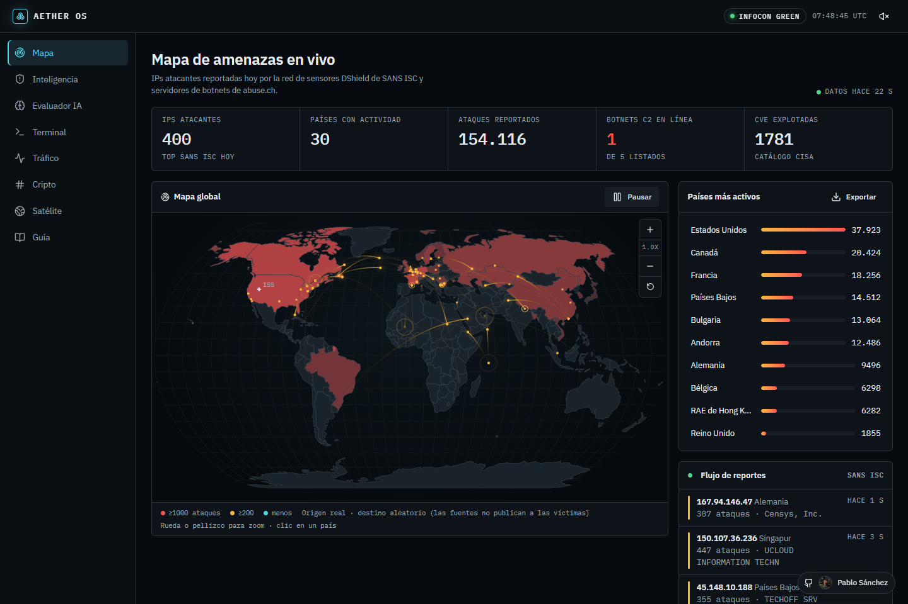
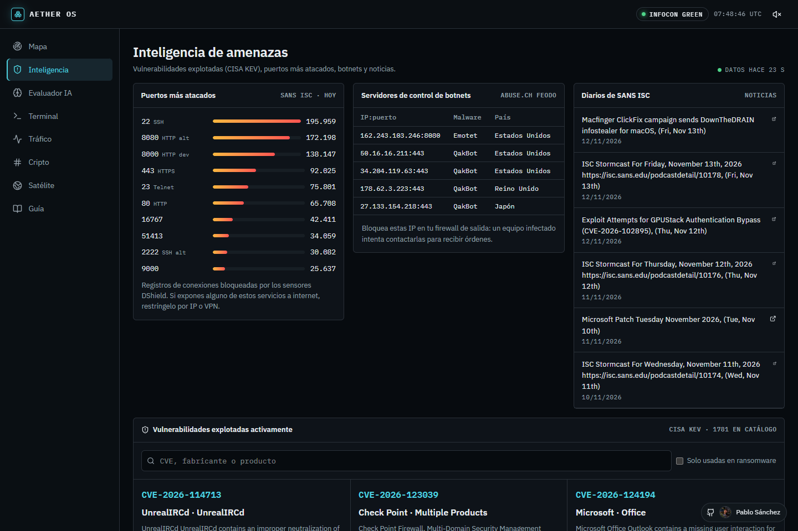
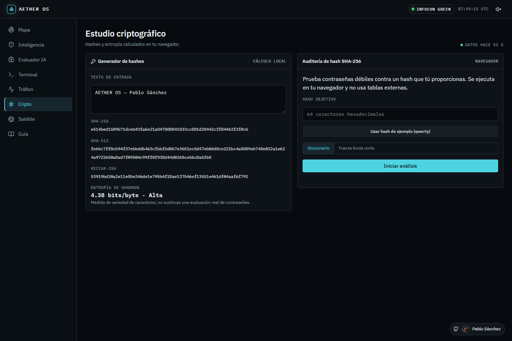

# AETHER OS

**Pablo Sánchez** · [@pablo2611](https://github.com/pablo2611)

[Español](#español) · [English](#english) · [Capturas / Screenshots](#capturas--screenshots)



## Español

AETHER OS es un panel educativo de ciberseguridad defensiva. Reúne reportes públicos de SANS Internet Storm Center, CISA y abuse.ch para que puedas pasar de una vista global a los datos que la explican.

| Módulo | Qué puedes hacer |
| --- | --- |
| Mapa e inteligencia | Explorar actividad reportada, puertos observados e indicadores públicos. Consultar vulnerabilidades conocidas en CISA KEV. |
| Terminal y tráfico | Consultar DNS y reputación de IPv4. Observar las solicitudes de red generadas por esta pestaña. |
| Criptografía | Calcular hashes y medir la entropía de texto en el navegador. |
| Satélite y guía | Consultar la posición de la ISS y leer medidas de protección y respuesta. |
| Evaluador de incidentes | Obtener orientación defensiva a partir de una descripción. Este módulo opcional requiere una credencial del proveedor de IA en el servidor. |

El mapa anima reportes agregados. Los destinos de las animaciones son ilustrativos. La disponibilidad de los datos depende de las fuentes externas.

### Ejecutar en local

Instala Node.js 22.12 o posterior y Bun. Ejecuta estos comandos y abre la URL que indique Vite.

```sh
git clone https://github.com/pablo2611/aether-os.git
cd aether-os
bun install --frozen-lockfile
bun run dev
```

Usa `bun run test` para ejecutar las pruebas y `bun run build` para compilar. Comparte un módulo con el parámetro `view`, por ejemplo `/?view=intel` o `/?view=crypto`. Un despliegue completo requiere un entorno compatible con las funciones de servidor de TanStack Start.

## English

AETHER OS is an educational dashboard for defensive cybersecurity. It brings together public reporting from SANS Internet Storm Center, CISA, and abuse.ch so you can move from a global view to the underlying reports.

| Module | What you can do |
| --- | --- |
| Map and intelligence | Explore reported activity, observed ports, and public indicators. Browse known exploited vulnerabilities in CISA KEV. |
| Terminal and traffic | Run DNS and IPv4 reputation lookups. Inspect network requests generated by the current browser tab. |
| Cryptography | Calculate hashes and measure text entropy in your browser. |
| Satellite and guide | Check the ISS position and review protection and incident response guidance. |
| Incident evaluator | Turn an incident description into defensive guidance. This optional module requires an AI provider credential on the server. |

The map animates aggregated reports. Animated destinations are illustrative. Data availability depends on the upstream sources.

### Run locally

Install Node.js 22.12 or later and Bun, run the commands below, then open the URL printed by Vite.

```sh
git clone https://github.com/pablo2611/aether-os.git
cd aether-os
bun install --frozen-lockfile
bun run dev
```

Run `bun run test` for the test suite and `bun run build` for a production build. Link directly to a module with the `view` parameter, such as `/?view=intel` or `/?view=crypto`. A full deployment requires a runtime that supports TanStack Start server functions.

## Capturas / Screenshots

### Inteligencia de amenazas / Threat intelligence



### Estudio criptográfico / Cryptography studio



## Fuentes y tecnología / Sources and stack

- [SANS Internet Storm Center](https://isc.sans.edu/) — informes de sensores, puertos y estado Infocon / sensor reports, ports, and Infocon status.
- [CISA Known Exploited Vulnerabilities](https://www.cisa.gov/known-exploited-vulnerabilities-catalog) — catálogo de vulnerabilidades con explotación conocida / catalog of known exploited vulnerabilities.
- [abuse.ch Feodo Tracker](https://feodotracker.abuse.ch/) — indicadores públicos de infraestructura de botnets / public indicators of botnet infrastructure.
- **Stack** — React, TypeScript, TanStack Start, TanStack Query, Vite y / and Nitro. D3 and Leaflet power the maps.
